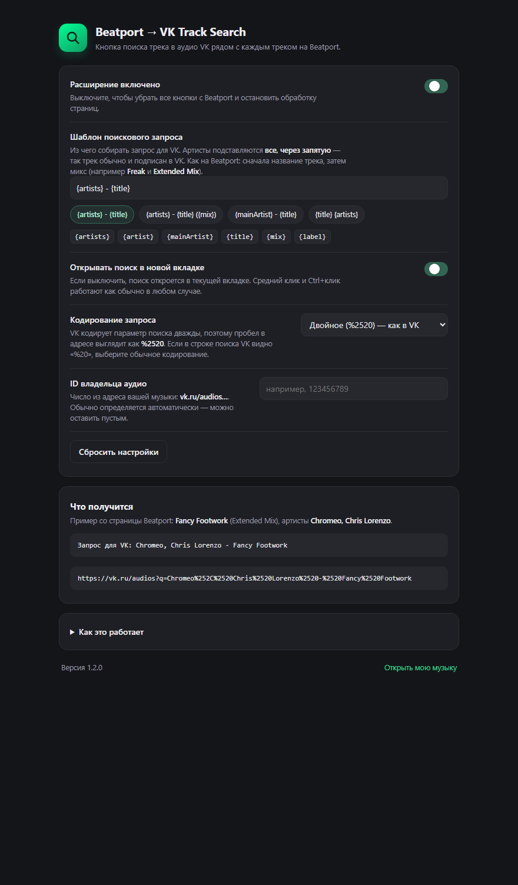

# Beatport → VK Track Search

Расширение Chrome, которое добавляет на Beatport кнопку поиска трека в аудио VK.
Работает как продолжение расширения для треклистов VK: там трек искали по строке
поста, здесь — по самому треку на Beatport.

Дата: 2026-10-18. Версия: **1.1.0**. Автотесты: **98/98** (jsdom).

## Коротко

- Рядом с названием трека на Beatport появляется кнопка с лупой.
- Клик открывает страницу музыки VK с уже заполненным поиском:
  `https://vk.ru/audios<ID>?q=<запрос>`, где `q` закодирован **дважды**
  (`%2520` вместо `%20`) — VK сам декодирует параметр ещё раз.
- Запрос по умолчанию — `Исполнитель - Название` (первый артист, без микса).
  Шаблон запроса настраивается: `{artist}`, `{artists}`, `{title}`, `{mix}`, `{label}`.
- Кнопка есть и у релизов, где отдельного трека нет: карточки «Latest … Music
  Releases», hero-блоки и строки-релизы в списках. Там ищется релиз целиком —
  `артист — название релиза`, для синглов это ровно то, что нужно.
- ID владельца аудио расширение подсматривает в адресе `vk.ru/audios<ID>`;
  до первого такого визита ссылка идёт на `/audios?q=…`, а вкладка VK
  достраивает переход сама.
- Кнопка — обычная ссылка, поэтому Ctrl+клик и средний клик открывают поиск
  в фоне, а текст и разметка Beatport не ломаются.

## Установка

1. Открыть `chrome://extensions`.
2. Включить «Режим разработчика».
3. «Загрузить распакованное расширение» → папка `extension/` (или
   `dist/beatport-vk-track-search/` из сборки).
4. Обновить вкладку Beatport и вкладку VK, если они были открыты.

Готовая сборка: `dist/beatport-vk-track-search-1.1.0.zip` (распаковывается в
папку, которую указывают в пункте 3).

## Как это работает

### 1. Где ищутся треки

Разметка снята с живых страниц Beatport. Кнопка ставится в пяти местах:

| Что это | Контейнер | Ссылка |
|---|---|---|
| Таблицы: топ-100, лейбл, артист, «другие треки» | `div[data-testid="tracks-table-row"]` | `a[href*="/track/"]` |
| Списки: треклист релиза, топ жанра, плейлисты | `div[class*="Lists-shared-style__ItemMeta"]` | `a[href*="/track/"]` |
| Списки релизов («Latest … Releases») | то же | `a[href*="/release/"]` |
| Шапка страницы трека | `div[class*="TrackHeader_meta"]` | `h1[class*="TrackHeader_name"]` |
| Карточки релизов (сетки и карусели) | `div[class*="ReleaseCard_wrapper"]` | `span[class*="releaseName"]` |
| Hero-блок релиза (крупный баннер) | `div.hero-release` | `span[class*="HeroRelease_releaseName"]` |

Ссылки ищутся по вхождению (`href*=`), а не по началу адреса: в языковых
версиях магазина они выглядят как `/es/track/mumble/30175842`,
`/es/artist/…`, `/es/label/…`. Номер трека или релиза берётся из адреса в любом
из вариантов, поэтому на `/es/`, `/de/` и остальных кнопка работает так же.

Название и микс на Beatport лежат в одном элементе: текст узла — название,
вложенный `<span>` — микс.

```html
<span class="…ReleaseName…">Freak<!-- --> <span>Extended Mix</span></span>
```

Кнопка вставляется сразу после ссылки с названием, внутри строки заголовка
(`…TitleRow…`) или у названия в карточке — там же, где Beatport рисует свой
значок «explicit». В шапке трека и в hero-релизе — рядом с кнопками
play / add to queue / add to playlist.

У карточек и hero-блоков отдельного трека нет, поэтому ищется релиз целиком:
название релиза берётся из `ReleaseCard_releaseName` / `HeroRelease_releaseName`,
артисты — из `ArtistNames_artistNames` / `HeroRelease_artists`. Для синглов
название релиза совпадает с названием трека; для EP запрос будет по названию
релиза — это лучшее, что видно в карточке.

### 2. Как собирается запрос

`common.js → renderQuery(info, settings)`:

- артисты берутся из `ArtistNames_artistNames` (в шапке трека — `Artists_items`),
  дубликаты убираются;
- по умолчанию в запрос попадает первый артист и название: `Ink - Freak`;
- шаблон `{artist} - {title} ({mix})` даёт `Ink - Freak (Extended Mix)`,
  а если микса у трека нет — скобки убираются целиком, а не остаются пустыми;
- `{artists}` — все артисты через запятую: `Ink, Mesto - Freak`;
- шаблон без `{title}` считается негодным и заменяется значением по умолчанию.

### 3. Как строится ссылка

```text
encodeURIComponent("Ink - Freak")  =>  "Ink%20-%20Freak"
encodeURIComponent(ещё раз)        =>  "Ink%2520-%2520Freak"

https://vk.ru/audios123456789?q=Ink%2520-%2520Freak
```

Почему дважды: VK декодирует параметр поиска ещё раз, поэтому в адресах,
которые генерирует сам сайт, пробел выглядит как `%2520`. Если в строке поиска
VK видно `%20`, в настройках есть переключатель на обычное кодирование.

### 4. ID владельца аудио

Порядок: `audioOwnerId` из настроек → ID из адреса `vk.ru/audios<ID>` →
выученный `detectedAudioOwnerId` из `chrome.storage.local`.

Учит ID скрипт `vk.js` (он же стоит на `vk.ru` и `vk.com`). Ссылки со страниц
Beatport для этого не используются: там можно попасть на чужую музыку.

Если ID неизвестен, кнопка ведёт на `https://vk.ru/audios?q=…`, а нажатие
`mousedown`/`pointerdown`/`auxclick` кладёт запрос в
`chrome.storage.local.pendingAudioSearch`. Вкладка VK, открывшись:

- если `q` доехал — ничего не делает;
- если адрес стал `/audios<ID>` без `q` — переходит на
  `/audios<ID>?q=…` тем же кодированием;
- запись живёт 2 минуты и стирается при первом использовании.

Так первый клик работает ещё до того, как ID был выучен.

### 5. Одностраничное приложение

Beatport — Next.js: списки перерисовываются, адрес меняется без перезагрузки.
`content.js` держит `MutationObserver` на `<html>` (скан с задержкой 200 мс) и
раз в 800 мс сверяет `location.pathname + search`.

- Кнопка ищется по строке-хосту: если она уже есть, обновляется её адрес и
  подсказка, а не создаётся новая — дубликатов не бывает.
- Если строка исчезла (перерисовали список), её кнопка удаляется.
- Смена настроек в `chrome.storage.onChanged` применяется сразу, без перезагрузки.
- Выключение расширения снимает кнопки и останавливает наблюдатель.

## Настройки



Хранятся в `chrome.storage.sync`:

| Ключ | По умолчанию | Смысл |
|---|---|---|
| `enabled` | `true` | Расширение включено. |
| `queryTemplate` | `{artist} - {title}` | Шаблон поискового запроса. |
| `openInNewTab` | `true` | Открывать поиск в новой вкладке. |
| `queryEncoding` | `double` | Двойное кодирование `q` (как у VK). |
| `audioOwnerId` | `''` | Ручной ID владельца аудио. |

В `chrome.storage.local`:

- `detectedAudioOwnerId` — ID, подсмотренный в адресе `/audios<ID>`;
- `pendingAudioSearch` — отложенный запрос для вкладки VK.

## Файлы

```text
extension/
  manifest.json
  common.js           настройки по умолчанию + сборка запроса и адреса
  content.js          Beatport: поиск треков, кнопки, перерисовка
  content.css         стиль кнопки
  vk.js               VK: обучение ID и достройка отложенного запроса
  background.js       клик по иконке открывает настройки
  options.html/css/js страница настроек с предпросмотром
  icons/              16/32/48/128
test/
  fixture.html        разметка Beatport: таблица, список, шапка, карточка, hero, строка-релиз
  fixture-locale.html локализованная страница: ссылки вида /es/track/…
  run-tests.mjs       тесты на jsdom (98 проверок)
  .deps/              jsdom для тестов
tools/
  build.ps1           сборка dist/ и ZIP (с проверкой манифеста и запуском тестов)
  make_icons.py       генерация иконок
dist/
  beatport-vk-track-search-1.1.0.zip
```

## Тесты и сборка

```bash
node test/run-tests.mjs
```

```powershell
powershell -ExecutionPolicy Bypass -File tools\build.ps1 -Test
```

Что покрыто тестами:

- пять мест установки кнопок: таблицы, списки, шапка трека, карточка релиза,
  hero-блок, а также строка-релиз со ссылкой на `/release/`;
- точные запросы и адреса, включая `%2520` и `%2526`;
- шаблоны `{artist} - {title} ({mix})` (и отсутствие пустых скобок),
  `{artists}`, `{title} {artist}`, `{label}`, негодный шаблон;
- позиция кнопки: сразу после ссылки с названием, внутри `…TitleRow…`;
  в карточке — у названия, а не у обложки; в hero — в ряду действий;
- у трека ключом становится ID трека, а не ID обложки-релиза;
- ID из настроек, выученный ID, нечисловой ID, одинарное кодирование;
- `openInNewTab`, отложенный запрос, отсутствие всплытия клика до строки Beatport;
- реакция на смену настроек и на появление ID без перезагрузки;
- удаление строки, добавление новой, SPA-переход без дубликатов;
- локализованные страницы (`/es/track/…`): артисты, номер трека и ссылка;
- `vk.js`: обучение ID, достройка `q`, «q уже есть», просроченная запись;
- страница настроек: заполнение, предпросмотр, пресеты, сброс, запись в storage;
- манифест: MV3, порядок скриптов, хосты, иконки.

Ограничение проверки: живой браузерный прогон на beatport.com не удался —
headless-Chrome получает от Beatport страницу Cloudflare вместо магазина, а под
песочницей этой среды Chrome не стартует. Поэтому разметка была снята с реальных
страниц (топ-100, лейбл, артист, страница трека, жанр), зафиксирована в
`test/fixture.html`, и прогон идёт на ней. В браузере стоит один раз прокликать
страницы из раздела «Если что-то сломалось» — особенно внешний вид кнопки.

## Ограничения

- Всё завязано на разметку Beatport: `data-testid="tracks-table-row"`,
  `Lists-shared-style__ItemMeta`, `TrackHeader_meta`, `ReleaseCard_wrapper`,
  `HeroRelease_wrapper`, `…TitleRow…`. Beatport может её поменять.
- У карточки или hero-блока в разметке нет ни одного трека — только название
  релиза, артисты и лейбл. Поэтому для сборных релизов (EP, компиляций) запрос
  строится по названию релиза и в VK может не найтись; для синглов всё сходится.
- Запрос собирается только из того, что видно в строке: артисты, название, микс,
  лейбл. Ремиксеры, BPM и тональность не используются.
- Первый поиск после установки может открыть `/audios` без ID — вкладка VK
  достроит адрес; дальше кнопки сразу ведут на `/audios<ID>`.
- Расширение не делает ни одного сетевого запроса: только DOM Beatport и
  `chrome.storage`.

## Если что-то сломалось

1. Обновить вкладку Beatport (`F5`) и проверить, что расширение включено.
2. В DevTools убедиться, что строки треков на месте: `[data-testid="tracks-table-row"]`
   или `[class*="Lists-shared-style__ItemMeta"]`. Если у `<html>` нет атрибута
   `data-bp2vk-scans`, скрипт вообще не запускался (расширение выключено или
   вкладку не обновляли).
3. Проверить, что у трека есть ссылка `a[href*="/track/"]` (у релиза —
   `a[href*="/release/"]`), а в шапке трека — `h1[class*="TrackHeader_name"]`.
4. Если разметка изменилась — править `TABLE_ROW`, `LIST_ITEM`, `TRACK_HEADER`,
   `RELEASE_CARD`, `RELEASE_HERO`, `NAME_SELECTOR`, `ARTISTS_BOX` в `content.js`.
5. Прогнать `node test/run-tests.mjs`; новый случай добавить в `test/fixture.html`.
6. Если ссылка открывается, но в поиске VK видно `%20` — переключить
   «Кодирование запроса» на обычное.
7. Если поиск открывается без запроса — открыть `vk.ru/audios` один раз,
   чтобы расширение выучило ID владельца аудио.

Ключевые функции: `content.js` — `readInfo`, `findNameNode`, `splitName`,
`readArtists`, `buildQuery`, `insertionPoint`, `scan`; `common.js` —
`renderQuery`, `encodeQuery`, `buildSearchUrl`.

## История

**1.1.0** — кнопка появилась у релизов: карточки «Latest … Music Releases»,
hero-блоки и строки-релизы в списках (запрос по названию релиза).
**1.0.0** — первая версия для треков: таблицы, списки, шапка страницы трека.

Сделано по мотивам расширения `vk-tracklist-track-search`, где трек искался по
строке треклиста в постах VK. Логика адреса поиска, двойного кодирования, ID
владельца аудио и отложенного запроса перенесена оттуда; здесь она применяется
к разметке Beatport.
